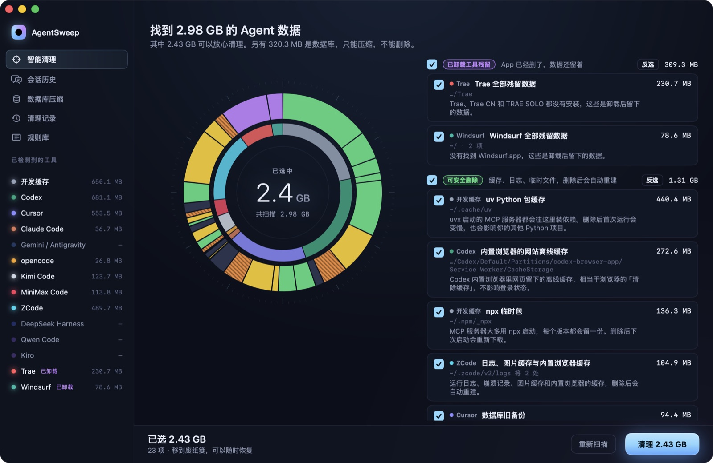
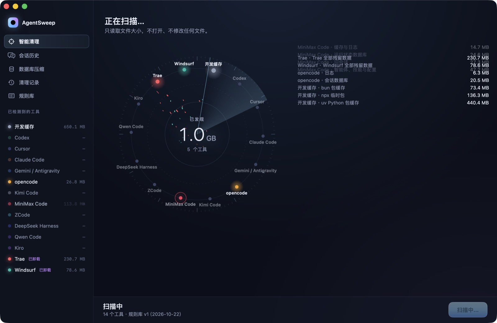
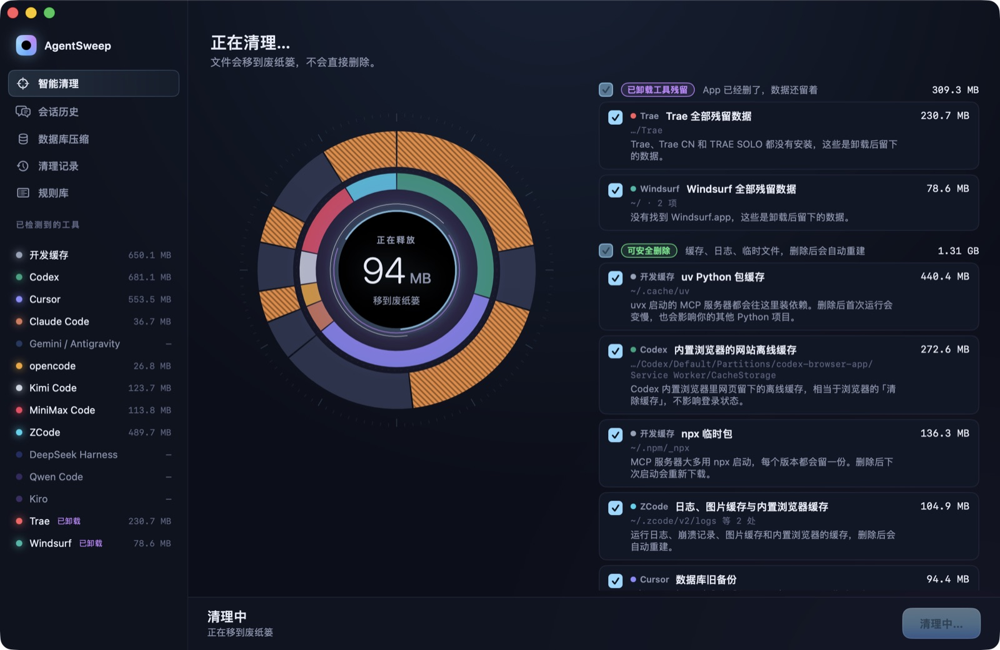
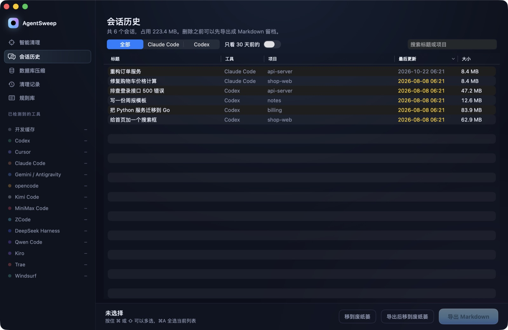
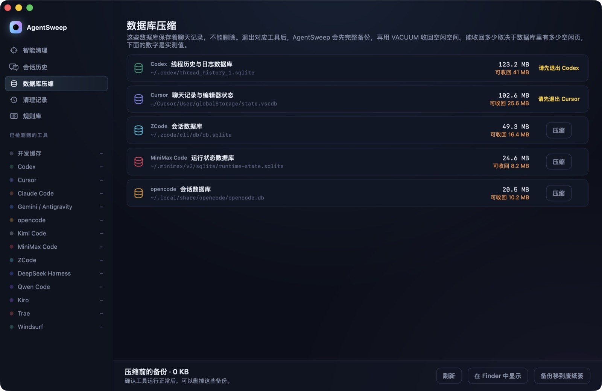

# AgentSweep

[English](README.md) · **简体中文**

专门清理 AI 编程工具产生的文件的 macOS 原生应用。

现在很多开发者同时装着好几个 AI 编程工具：Claude Code、Codex、Cursor、Gemini、Kimi Code、MiniMax Code、ZCode、opencode……它们会在主目录里不停写入会话记录、SQLite 数据库、浏览器缓存、npx/uv 依赖包，卸载之后还会留下一堆残留。一台日常开发机上，这些加起来往往有**几十 GB**。

通用的清理工具只能告诉你「这个文件夹很大」，却没法告诉你删了会不会丢聊天记录、会不会掉登录。AgentSweep 认识每个工具的目录结构，给每一项都配上一句人话说明，只清理能确认安全的东西。



## 功能

- **扫描**：每个工具是轨道上的一颗星，扫到哪个，哪个就亮起来，发现的数据化作光点流进中心的计数。
- **查看结果**：双层圆环图，内环是工具，外环是具体条目，颜色代表风险等级。悬停看说明，点击勾选，也可以按分组全选或反选。
- **清理**：选中的内容随着黑洞动画移到废纸篓。每次清理都会记下原路径，可以放回原处。
- **会话历史**：浏览 Claude Code 和 Codex 的会话，包括 Codex 压缩成 `.jsonl.zst` 的旧会话。删除前可以先导出成 Markdown。
- **数据库压缩**：Cursor 的 `state.vscdb` 这类聊天数据库永远不删。AgentSweep 先备份，再执行 `VACUUM`，并如实显示能收回多少空间。
- **卸载残留检测**：App 已经删了、数据还留着的工具（Trae、Windsurf……）会被单独找出来。
- **发现未收录的工具**：列出看起来像 AI 工具、但规则库还没覆盖的文件夹。只展示，永远不会清理。
- **可扩展的规则**：放一个 JSON 文件就能新增或覆盖工具规则，不用改代码，也不用重新编译。

| 扫描 | 清理 |
|---|---|
|  |  |
| **会话历史** | **数据库压缩** |
|  |  |

## 支持的工具

| 工具 | 能处理的内容 |
|---|---|
| Claude Code | 旧会话（可导出）、文件修改快照、缓存、日志、配置备份 |
| Codex（命令行和桌面版） | 旧会话（含 `.zst`，可导出）、已归档会话、线程数据库（仅压缩）、桌面版和内置浏览器缓存、临时文件 |
| Cursor | 聊天数据库（仅压缩）、旧项目工作区状态、后台 Agent 留下的代码副本、缓存、`.vsix` 安装包 |
| Gemini / Antigravity | CLI 检查点、缓存、编辑器缓存和工作区状态 |
| Kimi Code | 会话、查询缓存、日志、桌面版缓存 |
| MiniMax Code | 会话、后台任务、运行状态数据库（仅压缩）、缓存 |
| ZCode | 会话工作目录与产物、代码检查点、会话数据库（仅压缩）、内置浏览器缓存 |
| DeepSeek Harness | 会话、桌面版缓存 |
| opencode | 会话数据库（仅压缩）、快照、日志 |
| Qwen Code、Kiro | 会话、缓存、日志 |
| Trae / TRAE SOLO、Windsurf | 缓存；App 卸载后的全部残留 |
| 共用开发缓存 | `uv`、`npx`、`bun`、`pip`（大多数 MCP 服务器都靠它们启动） |

## 怎么保证安全

每条规则都属于五个风险等级之一：

| 等级 | 含义 | 默认 |
|---|---|---|
| 已卸载工具残留 | App 已经删了，数据还留着 | 勾选 |
| 可安全删除 | 缓存、日志、临时文件，删除后会自动重建 | 勾选 |
| 旧会话与历史 | 30 天没动过的记录，可以先导出 | 勾选 |
| 数据库 · 仅压缩 | 永远不删，只备份后执行 `VACUUM` | 锁定 |
| 受保护 | 登录凭证、配置、技能、插件、程序本体 | 锁定 |

- **白名单原则**：没有规则覆盖的文件一律不动。受保护规则命中的路径，以及包含它们的上级目录，都不能被选中。
- **硬性护栏**：主目录、`~/Library`、`~/.cache` 这类根级目录，即使规则写错了也不会被整个删掉。
- **不直接删除**：所有内容都移到废纸篓，清理记录保存在 `~/Library/Application Support/AgentSweep/history/`。
- **检测运行中的工具**：清理正在运行的工具前会提醒；对应工具没退出时，不允许压缩它的数据库。

## 安装

1. 在 [Releases](https://github.com/ai-suifeng/agent-clean-mac/releases) 下载 `AgentSweep-<版本号>.dmg`。
2. 把 **AgentSweep** 拖进「应用程序」文件夹。
3. 目前的安装包还没做苹果公证，第一次打开会被 macOS 拦下。右键点应用选「打开」，或者在终端运行：

   ```bash
   xattr -dr com.apple.quarantine /Applications/AgentSweep.app
   ```

需要 macOS 14 Sonoma 或更新版本，Apple 芯片和 Intel 都能原生运行。

## 使用方法

1. **智能清理**：点「开始扫描」。查看结果，按条目或按分组调整勾选，然后点「清理」并确认。
2. **会话历史**：按工具、时间或关键字筛选会话。选中后可以「导出 Markdown」「导出后移到废纸篓」或直接「移到废纸篓」。
3. **数据库压缩**：先退出对应工具，再点「压缩」。压缩前的备份会一直保留，直到你手动删除。
4. **清理记录**：每次清理的明细，带「恢复」按钮。
5. **规则库**：全部规则、可能还没收录的工具，以及本地规则文件夹的入口。

**清空废纸篓之后，磁盘空间才会真正释放。** 在那之前，每次清理都可以恢复。

**重启应用后再恢复**，可能需要「完全磁盘访问权限」，因为 macOS 会保护废纸篓。没有这个权限时，AgentSweep 会告诉你哪些文件需要在 Finder 里右键「放回原处」。

## 添加新工具

把 JSON 文件放进 `~/Library/Application Support/AgentSweep/rules.d/`，重启应用即可生效。`id` 和内置工具相同时，会替换内置规则。

```json
{
  "tools": [
    {
      "id": "my-agent",
      "name": "My Agent",
      "color": "#22C55E",
      "detect": { "paths": ["~/.my-agent"], "apps": ["My Agent.app"], "processes": ["my-agent"] },
      "orphanWhenAppMissing": true,
      "rules": [
        { "id": "ma-protected", "label": "配置", "paths": ["~/.my-agent/config.json"], "risk": "protected", "action": "none", "explain": "设置和登录信息。" },
        { "id": "ma-sessions", "label": "旧会话", "paths": ["~/.my-agent/sessions/*"], "risk": "history", "action": "age-filter", "ageUnit": "entry", "explain": "聊天记录。" },
        { "id": "ma-cache", "label": "缓存", "paths": ["~/.my-agent/cache"], "risk": "safe", "action": "trash", "explain": "删除后会自动重建。" },
        { "id": "ma-orphan", "label": "残留数据", "paths": ["~/.my-agent"], "risk": "orphan", "action": "trash", "onlyWhen": "appMissing", "explain": "App 已经卸载。" }
      ]
    }
  ]
}
```

- **路径**支持 `~`、`*`、`?`、`{a,b}` 和 `**`。
- **`risk`**：`orphan`、`safe`、`history`、`compact` 或 `protected`。
- **`action`**：`trash`、`age-filter`（只处理 30 天前的内容；加上 `"ageUnit": "entry"` 表示按整个匹配到的文件夹判断新旧）、`vacuum`（SQLite 压缩）或 `none`。

欢迎给内置的 [`rules.json`](Sources/AgentSweepCore/Resources/rules.json) 提交新工具的规则。

## 从源码构建

需要 Xcode 16 或更新版本（Swift 5.10 以上）。

```bash
git clone git@github.com:ai-suifeng/agent-clean-mac.git
cd agent-clean-mac
swift test                                  # 运行核心库测试
scripts/build-app.sh --open                 # 构建本机架构的 build/AgentSweep.app 并打开
scripts/build-app.sh --universal --dist     # 构建通用版，并在 build/ 下生成 .zip 和 .dmg
```

推送 `v0.2.0` 这样的版本标签后，GitHub Actions 会自动构建通用版的 `.dmg` 和 `.zip`，并发布到 Releases。

### 开发参数

```bash
open build/AgentSweep.app --args --scan                # 启动后直接扫描
open build/AgentSweep.app --args --section sessions    # 打开指定页面：clean / sessions / compact / history / rules
open build/AgentSweep.app --args --home /tmp/fake-home # 把另一个文件夹当作主目录
# 仅调试版（scripts/build-app.sh --debug）：播放清理动画，但不移动任何文件
open build/AgentSweep.app --args --home /tmp/fake-home --scan --demo-clean
```

## 目录结构

| 位置 | 内容 |
|---|---|
| `Sources/AgentSweepCore/Resources/rules.json` | 内置规则库 |
| `Sources/AgentSweepCore/` | 路径匹配、扫描、移到废纸篓与恢复、SQLite 压缩、会话导出、未收录工具发现、进程检测 |
| `Sources/AgentSweep/` | SwiftUI 界面。`StageEngine.swift` 用 `Canvas` + `TimelineView` 绘制扫描、圆环和黑洞动效 |
| `scripts/` | 打包、生成安装包和应用图标的脚本 |
| `docs/PRD.md` | 产品需求文档 |
| `prototype/agentsweep.html` | 界面的交互式 HTML 原型 |

## 已知限制

- 界面目前只有中文。
- 会话导出目前支持 Claude Code 和 Codex，Cursor、Gemini、opencode 等还在计划中。
- 导出 Codex 的 `.jsonl.zst` 会话需要先安装 `zstd`（`brew install zstd`）。
- Cursor 的聊天数据库通常空闲页很少，`VACUUM` 收回不了多少空间；按对话清理旧记录还在计划中。
- 发布的安装包只做了本机签名（ad-hoc），还没有做苹果公证。

## 许可证

[MIT](LICENSE)
